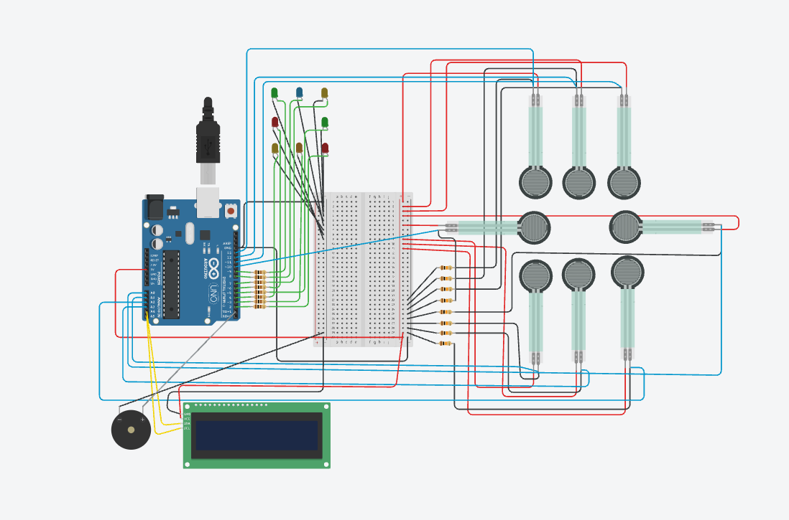

# Interactive Jump Mat

An Arduino-based reaction and memory game designed for a physical jump pad divided into 8 zones. In each round, LEDs in two or more zones light up randomly, and the player must press the corresponding force sensors (FSRs) before the time runs out.

The game displays the current score and level on an LCD screen (via I2C communication), produces sounds using a piezoelectric buzzer, and uses LEDs to signal the start of the game, a successful action, advancing to the next level, or the end of the game ("Game Over").

## How to Play

1. Power on the Arduino.
2. Wait for the startup sequence to complete.
3. Press only the sensors (FSRs) corresponding to the illuminated LEDs.
4. Complete the round before the time expires.
5. Pressing an incorrect sensor, or failing to press a target that has appeared, results in the end of the game.

The game begins with 2 targets (illuminated LEDs). Progression works as follows:

- Every 10 points, the game advances to the next level.
- The time allotted for each round decreases as the speed increases.
- Every three levels, the number of targets (illuminated LEDs) increases. - The score required to advance to the next level starts at 10 and increases by 20% with each subsequent level.

## Hardware

- Arduino Uno-compatible board
- 8 LEDs
- 8 Force Sensors (FSRs)
- Resistor circuits (pull-resistors) for the FSR inputs
- 16×2 LCD display with an I2C interface (using the `Adafruit_LiquidCrystal` library)
- Piezo buzzer
- Breadboard and jumper wires

### Pin Mapping

| Zone | LED Pin | FSR Pin | Musical Note |
|---|---:|---:|---|
| 1 | 13 | 9 | C4, 262 Hz |
| 2 | 12 | 8 | D4, 294 Hz |
| 3 | 11 | 7 | E4, 330 Hz |
| 4 | 10 | 6 | F4, 349 Hz |
| 5 | 5 | A0 | G4, 392 Hz |
| 6 | 4 | A1 | A4, 440 Hz |
| 7 | 3 | A3 | B4, 494 Hz |
| 8 | 2 | A2 | C5, 523 Hz | Additional Connections:

- Piezo buzzer: Digital pin 1
- I2C LCD display: Uses the MCP23008 component, operated via the `Adafruit_LiquidCrystal` library.

## Project Structure

- `jumping_surface.ino` – The Arduino entry point (main file)
- `src/Game.cpp` / `src/Game.h` – Logic for rounds, scoring, levels, and game-over states
- `src/Constants.cpp` / `src/Constants.h` – Pin definitions, hardware components, and tuning constants
- `src/Section.h` – Definitions for an individual section, including LEDs, FSR sensors, and sounds
- `src/inputs/FsrManager.cpp` – Reading data from FSR sensors and handling debouncing
- `src/outputs/LcdManager.cpp` – Managing messages on the LCD display and showing the score
- `src/outputs/LedManager.cpp` – Managing LED lighting patterns and visual feedback effects
- `src/outputs/BuzzerManager.cpp` – Managing sounds for the various sections and providing audio feedback for the game
- `src/outputs/IGameLifecycle.h` – A common interface for managing the game's lifecycle

